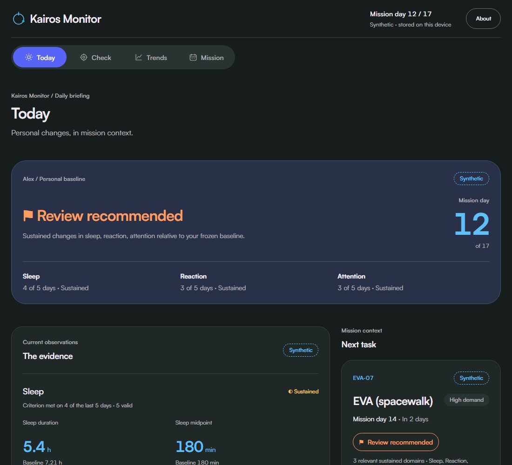

<div align="center">


# Kairos Monitor

**Personalized Astronaut Functional Readiness & Early-Warning System**

A NASA Space Apps prototype by **Team Requiem_SUST**.

[Live demo](https://kairos-monitor-gamma.vercel.app) · [Demo walkthrough](DEMO.md#3-the-90-second-demo-script) · [Development guide](docs/DEVELOPMENT.md) · [Contributing](CONTRIBUTING.md)

**Offline-first · Explainable · Synthetic mission telemetry**

</div>

---

Kairos Monitor compares observations with a frozen personal baseline, highlights sustained changes in sleep, reaction and attention, and shows their relevance to upcoming mission tasks. A deterministic engine produces the evidence and classifications; optional Gemini rephrasing makes that evidence easier to read.

> **Prototype scope:** All mission telemetry is synthetic. Thresholds and task classifications are experimental and illustrative. Task decisions remain with the crew and mission team. Kairos Monitor is not a validated clinical or flight assessment.



*Synthetic day-12 dashboard. [Screenshot provenance](public/images/README.md).*

## Capabilities

| Capability | What it provides |
|---|---|
| Personal baseline | Frozen values from mission days 1–7; later observations never replace it automatically. |
| Sustained-change detection | Domain criteria evaluated across the last five days, with explicit quality and availability checks. |
| Task context | Separate concern levels and explanations for EVA, Docking, Maintenance and Inventory. |
| Browser checks | Measured reaction and go/no-go attention checks with explicit saves, quality reasons and local history. |
| Explainable results | Immediate deterministic templates; validated, optional AI rephrasing from the same synthetic evidence. |
| Local persistence | IndexedDB storage for mission state, responses, live results and validated explanations. |
| Offline operation | Production app shell and checks work after an initial online visit and completed precaching. |
| Research context | Attributed HERA and ISS summaries, source links and published-study facts in About. |

The application includes a landing page and four console screens: **Today**, **Check**, **Trends** and **Mission**. Synthetic observations carry visible provenance; real browser measurements are labeled **Live browser test** and remain separate from mission calculations and Gemini requests.

## Quick start

Use **Node.js 22.12.0 or newer** and npm. Install the exact dependency versions from the lockfile:

```sh
git clone https://github.com/xeon797/kairos-monitor.git
cd kairos-monitor
npm ci
npm run dev
```

Open the local URL printed by Vite, usually `http://localhost:5173`. No API key is required: deterministic explanations work immediately. Vite dev and preview do not execute `api/explain.ts`; the development server also has no service worker.

For Satoshi typography, obtain the official Regular, Medium and Bold WOFF2 files from [Fontshare](https://www.fontshare.com/fonts/satoshi) and place them in `public/fonts/`. On Windows, the existing installer is available:

```powershell
powershell -File scripts/install-satoshi.ps1
```

Read the included font license. Font binaries are Git-ignored; each recipient obtains their own copy. Without them, the application uses its system font stack. Install the fonts before final font/offline acceptance checks. See the [font guide](public/fonts/README.md) and [third-party materials](THIRD_PARTY.md).

## Commands

| Command | Purpose |
|---|---|
| `npm run dev` | Start the Vite development server. |
| `npm run typecheck` | Check strict TypeScript types. |
| `npm run test` | Run the Vitest unit suite. |
| `npm run build` | Typecheck and create the production build in `dist/`. |
| `npm run e2e` | Run Playwright against production preview. Build first. |
| `npm run preview` | Serve the production build locally. |

To verify a checkout:

```sh
npx playwright install chromium
npm run typecheck
npm run test
npm run build
npm run e2e
```

Default browser tests use isolated storage, mocked AI and controlled check timing. Real-provider and real-clock checks are explicit opt-ins; their commands and recorded evidence are in the [verification guide](docs/VERIFICATION.md).

## Demo walkthrough

Launch the demo and use the **Simulation** panel to navigate the 17-day synthetic timeline.

| Mission day | Expected behavior |
|---|---|
| 7 | **Within your usual range**; the personal baseline is established and frozen. |
| 11 | **Change noted**; sleep is the first sustained domain. |
| 12 | **Review recommended**; sleep, reaction and attention meet criteria on **4/5, 3/5 and 3/5** days. |
| 12 — Mission | **EVA-07: Review recommended** and **INV-03: Change noted**, both scheduled in two days. |
| 13 | Log a human-entered schedule change. |
| 15 → 16 | Sustained domains fall from two to zero; the response comparison can show **Measures moving toward baseline**. |

The comparison always states: **This comparison does not show that the adjustment caused the change.** Poor or missing evidence produces **Insufficient data** when a domain cannot be evaluated.

The synthetic baseline is sleep **50.5 / 7 h**, midpoint **180 min**, reaction **265 ms**, lapses **1**, and commission errors **9 / 7**. Full-precision values drive calculations. Reset returns to day 7 and clears schedule-change responses while retaining the baseline, live results and explanation cache.

Live checks use **25 reaction trials** and **40 attention stimuli**. Reaction duration varies; a full check belongs before or after the 90-second pitch. Results are stored only after **Save result**. Separate live baselines use the first three valid results of the same test kind. See [DEMO.md](DEMO.md) for the complete scenario and acceptance contract.

## Architecture

```text
src/
  engine/       Pure TypeScript baseline, detection, task rules and evidence
  checks/       Browser test interfaces, scoring and live comparisons
  db/           Dexie schema and local persistence
  state/        Application state and mission controls
  screens/      Landing, Today, Check, Trends and Mission
  components/   Evidence, task, explanation and navigation interfaces
  ai/           Validated explanation requests and local cache
  research/     Presentation-only source catalogue
  styles/       Design tokens, self-hosted fonts and plain CSS
api/            Serverless Gemini REST endpoint
server/         Evidence-packet validation
tests/          Unit and browser verification
docs/           Development, verification, recording and source guides
public/         Icons, synthetic preview and local font directory
```

**Stack:** React 18, strict TypeScript, Vite, React Router, Dexie, Recharts, vite-plugin-pwa, Vitest and Playwright. No UI framework or Gemini SDK is used.

Data flows from observations through the frozen baseline and deterministic rules into an `EvidencePacket`. The UI and template render that packet immediately. The model may rephrase it only after validation; it cannot select a status, introduce numbers or change task decisions. All thresholds live in `src/engine/config.ts`.

## Configuration and deployment

| Server variable | Purpose |
|---|---|
| `GEMINI_API_KEY` | Credential for the optional server-side Gemini call. |
| `GEMINI_MODEL` | Model selected in the hosting environment. |

`.env.example` contains empty placeholders. Configure values only in a Git-ignored local environment or the hosting provider's server environment; never use a `VITE_` prefix for the key. Live browser results are never sent to Gemini. Failed, unavailable or rejected responses silently retain the template.

The public GitHub repository is connected to the existing Vercel project; `main` is its production branch. Deployment instructions cover linking the existing project, installing fonts, server configuration and asset verification in [Development & Operations](docs/DEVELOPMENT.md#gemini-and-deployment). A fresh checkout does not contain the original workspace's local Vercel link. Vercel's build command obtains the three official Satoshi files at build time when absent; font binaries remain excluded from Git and are self-hosted by the resulting application. A failed font installation stops that deployment.

## Offline behavior

An **initial online visit is required**. On the production site, wait for **Available offline on this browser after the initial online visit.** Once installed, route reloads, navigation, simulation, charts, About, checks and local saves work without network access.

The service worker precaches the shell and local assets and never caches `/api/*`. Explanations use a validated local AI cache or immediate templates. Updates wait for all controlled tabs to close; save unfinished results before closing and reopening online. Clearing site storage removes cached access and local records. A first visit while offline cannot install the application. Physical-device installation remains unverified.

## Verification status

The recorded research release passed **583 unit tests across 26 files**, typechecking, production build and **12 public browser checks at 360 / 1100 px**; all **16 runtime asset hashes** matched the reviewed build. These counts refer to the recorded application revision, not every later documentation commit.

**Project closeout remains partial:** the original-code license choice and a performed by-hand public rehearsal with capture are outstanding. Detailed results, earlier failures, skipped opt-ins and recording provenance remain in the [verification guide](docs/VERIFICATION.md) and [NOTES.md](NOTES.md). Automated tests establish software consistency, not clinical validity or mission suitability.

## Research and limitations

Browser/device latency, practice effects and interruptions affect short-test measurements. Thresholds and task rules are illustrative. The recovery scenario does not establish intervention effectiveness. HRV is unavailable and would be supporting context only; novelty versus prior work remains a claim to investigate.

HERA and ISS references provide published research context and protocol descriptions. **Participant-level NASA data are not imported.** Scheduled sleep opportunity is distinct from measured sleep. Kairos Monitor's browser checks are prototype adaptations, not validated replicas of NASA instruments. These research summaries never enter baseline, scoring, simulator or status calculations. No NASA endorsement is implied.

See [NASA source notes](docs/NASA_SOURCES.md) for authors, official links, PDF page references, reuse notices and data-access limits. Only attributed paraphrases and selected published facts are bundled; source PDFs, figures and participant records are excluded. Additional context is linked in the specification's [references](SPEC.md#18-references).

## Team and AI disclosure

**Team Requiem_SUST** owns the project and presentation. Responsibilities include science/product review, design and demonstration, engineering and deployment, and independent review of logic, accessibility and evidence. Individual assignments and credentials are not supplied here.

**Codex** assisted implementation, testing, review and documentation. **Google's Gemini** optionally rephrases synthetic evidence at runtime behind validation and template fallback. Neither provides clinical validation or determines classifications.

## License and attribution

**Original-code license selection is pending.** No project license grant is applied until the owner selects a license. Any chosen code license will remain separate from original artwork rights and third-party terms.

[THIRD_PARTY.md](THIRD_PARTY.md) records package versions, upstream licenses, font restrictions, service terms and research attribution. Preserve those notices when distributing source or builds. Satoshi binaries and supplied research PDFs are excluded from the repository.

## Future work

Wearable integration, cloud sync, multiple crew members, authentication, real NASA data ingestion, model training and push notifications remain outside the prototype. Other future work includes working-memory checks, HRV context, domain-expert validation and formal usability/physical-device testing. A licensed looping-video clip is optional presentation polish.

## Documentation

| Document | Purpose |
|---|---|
| [Development & Operations](docs/DEVELOPMENT.md) | Setup, optional Gemini configuration, deployment, offline updates and troubleshooting. |
| [Contributing](CONTRIBUTING.md) | Change workflow, verification and contributor requirements. |
| [AGENTS.md](AGENTS.md) | Coding-agent instructions and mandatory engineering rules. |
| [SPEC.md](SPEC.md) | Behavioral and numerical source of truth. |
| [DEMO.md](DEMO.md) | Exact synthetic fixture, acceptance checks and pitch script. |
| [DESIGN.md](DESIGN.md) | Screens, wording, tokens and accessibility rules. |
| [PLAN.md](PLAN.md) | Ordered tasks and completion status. |
| [Verification & Release Status](docs/VERIFICATION.md) | Recorded test evidence and remaining acceptance requirements. |
| [Recording guide](docs/RECORDING.md) | Presentation recording and public rehearsal checklist. |
| [NASA source notes](docs/NASA_SOURCES.md) | Research attribution, page references and usage limits. |
| [NOTES.md](NOTES.md) | Detailed decisions, checks, failures and evidence. |

The documents in `Kairos Monitor/MD files/` are historical planning copies. Use the root documents linked above for current implementation and task status.
